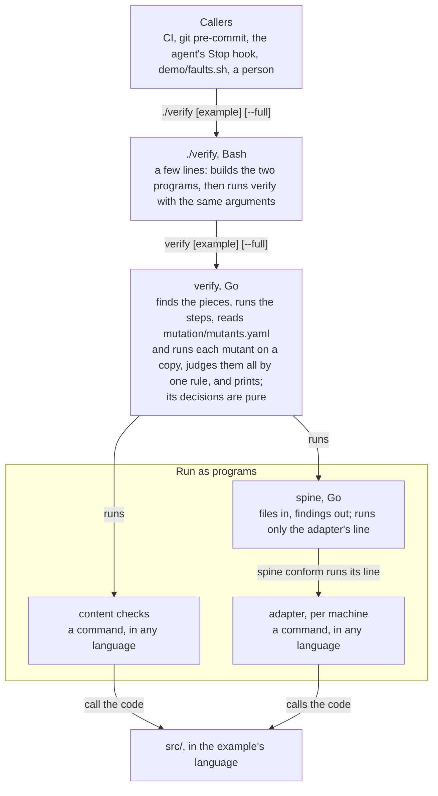

# 0007. No language built in, `verify` in Go, and examples set up alike

- Status: accepted
- Date: 2026-10-21
- Issue: #61

## Context

A reading of all the code, on `main` at `215c37f`, found where the toolkit and its three
examples had drifted apart (#61):

- `./verify` is 300 lines of Bash; no test makes it report `bad-command`, `ambiguous-piece`
  or `no-machines`, or misuse. It runs Python on every run, to quote `spine`'s path for
  `VERIFY_SPINE`, and to read each `.cmd` file, so every project needs Python, whatever its
  language.
- Python is built in. `./verify` finds a Python piece by its file name and sets `PYTHONPATH`
  for it; `spine conform --adapter` serves a Python file through a copy of
  `tools/adapter_shim.py` built into `spine`; `./verify` runs `tools/run_checks.py`. Any other
  language gives each piece as a `.cmd` line, as elixir_job does.
- Each example writes its own mutation loop, in 87, 113 and 105 lines, each judging its
  mutants its own way and calling the toolkit back.
- notes is the acceptance fixture, with a rule of its own in CLAUDE.md.

#61 plans the way from there, step by step; three independent reviews checked it. The owner
decided its D1 to D3 on 2026-10-21, and dropped its first rule, that nothing is taken away from
projects: no project uses the toolkit yet.

## Decision

1. **The rules the work follows:**
   - **No new dependencies,** and fewer where we can.
   - **Arrows only point down.** Callers run `./verify`; `./verify` runs `spine` and the
     root's commands; they call the code. The one exception is a mutation command, such as
     mutmut, which runs the oracle itself through `VERIFY_SPINE`, as mutation tools do. This
     repo's examples don't use one.
   - **Functional core, imperative shell.** Deciding is pure: parsing, checking, planning a
     run, judging it. Reading files, starting programs and printing happen around it, and
     decide nothing.
   - **Examples are equal.** They differ in what they show and in what their language
     dictates, never otherwise in how they are set up.

   Nothing is kept only because it exists: a change may remove something, and its issue says
   what. The spine format and the tool contract still change only through an issue the owner
   has approved, as CLAUDE.md says.
2. **notes stays the acceptance fixture** (D1). CLAUDE.md's rule protects it alone: it isn't
   edited to make a toolkit failure go away, and a toolkit change that needs it to change says
   why. In how it is set up, it is equal to the others. It alone keeps a first version of its
   code, `examples/notes/demo/notes_app_as_written.py`, with two bugs, for `demo/faults.sh` and
   `demo/live-builder.sh`.
3. **`verify` is a Go program, `tools/cmd/verify`** (D2). It does what `./verify` does: finds
   the roots and their pieces, runs `spine` as a separate program, runs the root's commands and
   the mutants, judges each step, and prints what `./verify` prints. Its decisions are pure.
   `./verify` stays the one entry point: a short Bash script that builds `spine` and `verify`
   into `tools/bin/` and runs `verify` with its arguments. `spine` stays files in, findings
   out: the one program it runs is the adapter's line, for `spine conform`, and nothing
   depends on its insides.
4. **No language built in** (D3). Every piece is a command, in any language:
   - the adapter, per machine: `conformance/adapter_<machine>.cmd`, whose line
     `spine conform --adapter-cmd` runs;
   - the content checks: `checks/run.cmd`;
   - mutation: `mutation/mutants.yaml` (decision 5), or `mutation/mutate_<name>.cmd` for a
     mutation tool.

   `./verify` looks for no Python file, sets no `PYTHONPATH` and picks no Python, and
   `spine conform` keeps `--adapter-cmd` only. `tools/adapter_shim.py` and
   `tools/run_checks.py` stay, as helpers that a Python project's command lines call. notes and
   ref_sync give their pieces as commands, as elixir_job does; this answers #60's OQ4.
5. **Mutation as data** (#58). `mutation/mutants.yaml` lists the mutants, each with a `name`, a
   `file` under `src/`, the text to `find`, which must occur there exactly once, and its
   `replace`ment. `verify` runs the code as it is first, then each mutant on a copy, running
   only the steps that read `src/`, and judges them all by one rule: `oracle-fails`,
   `mutant-killed`, `mutant-survived` or `mutant-stale`. #58 decides the rest.
6. **Conventions for this repo's examples** (#60), written in `examples/README.md` and checked
   by a test outside `tools/`, so that no project is held to them.

The target, layer by layer:

## Consequences

- Once #61's steps are done, `./verify` needs Go, Bash and `git`, and a project needs Python
  only for the pieces it writes in Python.
- `./verify` stops reading `PYTHON` and stops using `.venv` by itself. A Python project's
  command lines name its interpreter, or find it on `PATH`. CLAUDE.md's setup changes in the
  pull request that does it.
- The contract changes, through its own approved issue: `conform --adapter` goes, and with it
  `spine`'s copy of the shim and its use of `$PYTHON`; the table of pieces keeps the `.cmd`
  form only; `ambiguous-piece` can no longer arise, and is retired, never reused; the findings
  for a missing piece name the `.cmd` form only.
- notes and ref_sync gain `.cmd` files. notes changes, as CLAUDE.md allows for a toolkit
  change, with the reason stated.
- `demo/faults.sh` changes: scenarios 8 and 9 expect lines that name Python files, and
  scenario 10 runs notes through the adapter protocol, which scenario 1 then does too.
- It reverses ADR 0004's decision 8 (`--adapter FILE` through the shim), ADR 0005's decision 5
  (the Python names keep working) and the alternative ADR 0005 set aside, moving the Python
  examples to commands, and ADR 0006's decision 3, that `./verify` exports `PYTHON` for
  `spine`. The pull request that makes the change marks them.
- Open, for that pull request: how a command line reaches the helpers. In a project the toolkit
  sits at its root, so a line can say
  `python3 tools/adapter_shim.py conformance/adapter_notes.py`; in this repo an example sits two
  folders below `tools/`, and a `.cmd` line holds no variables. (Decided in #69, on 2026-10-23:
  `./verify` puts its `tools/` first on the `PATH` of the commands it runs, for any root that
  isn't its own folder too, so a line names a helper alone:
  `env PYTHONPATH=src adapter_shim.py conformance/adapter_notes.py`.)

## Alternatives considered

- **Every example protected by CLAUDE.md's rule** (D1). It would cover ref_sync and
  elixir_job too, which `demo/faults.sh` also seeds faults into and checks in every scenario.
  The owner kept notes as the one protected example.
- **`verify` as a command inside `spine`** (D2). One program, but `spine` would run projects'
  checks, adapters, mutants and `git`, and know their layout; the contract would have to
  describe it.
- **`./verify` kept in Bash, without Python** (D2). The smallest change, but Bash can't read
  `mutants.yaml`, and its quoting and process handling stay hard to test.
- **Python by name, as today** (D3). No contract change and no change to the examples, but
  Python stays built into `./verify` and `spine` beside the `.cmd` form: two ways to give a
  piece, one of them for a single language.
- **Every example by command, with Python by name kept for projects** (D3). The examples would
  match, but no example would use the Python form, which would need inputs of its own to stay
  tested.
- **More languages built in** (D3). Each needs toolkit code, a contract change and its own way
  of finding `src/`; no project has asked for one.
- **Keeping the rule that nothing is taken away.** Every change would add beside what exists,
  and the toolkit would keep forms that no project uses.
