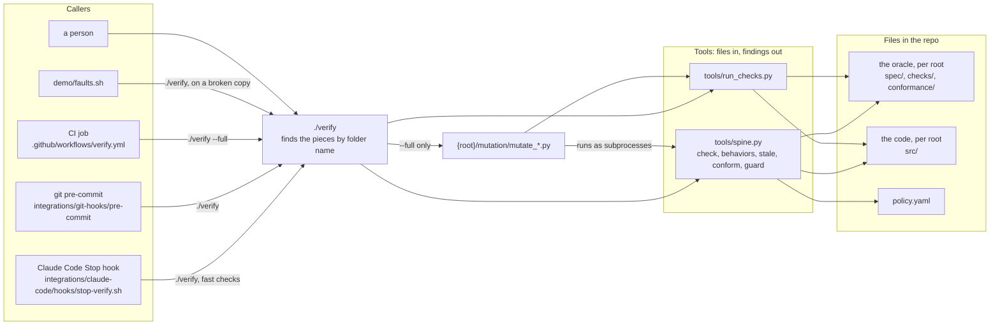
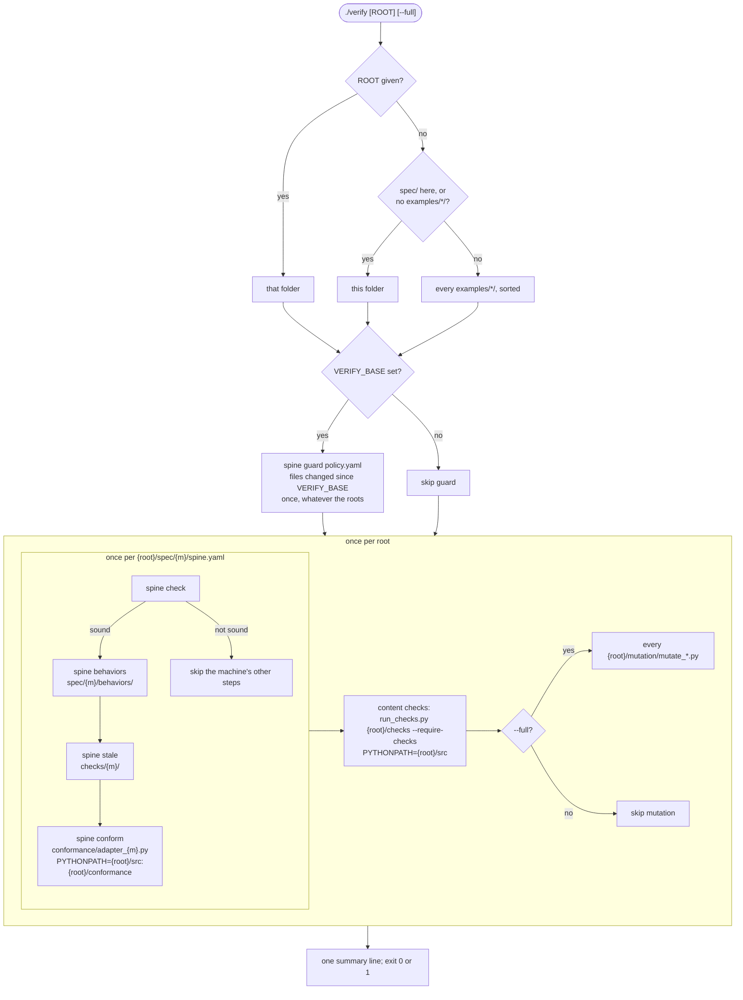
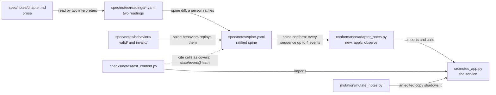
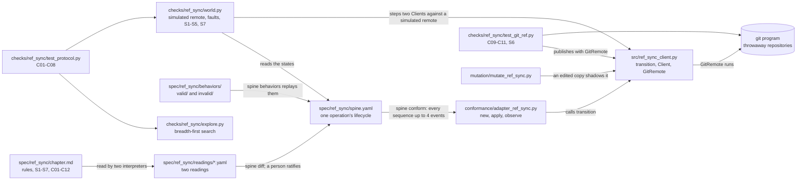
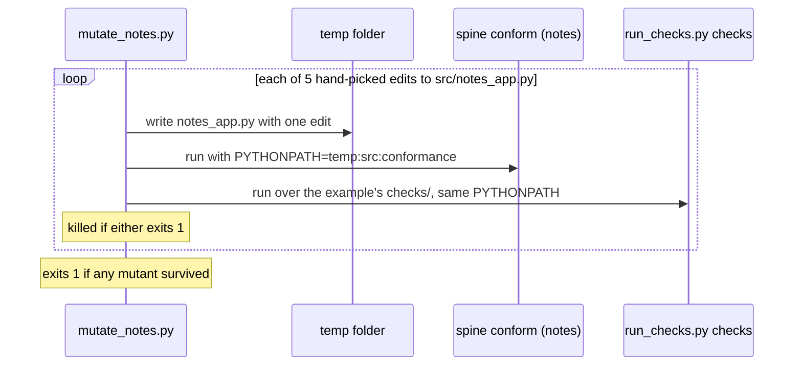
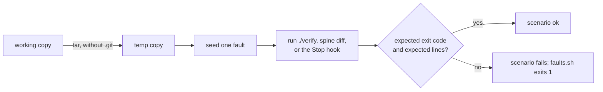

# Architecture

How the repo fits together today: who calls what, what `./verify` runs, how the examples are
wired, and how the toolkit checks itself. The rules each piece follows are in
`docs/reference/`; the reasons are in `docs/design.md`. In the diagrams, `{m}` is a machine's
folder name, such as `notes`, and `{root}` is the folder `./verify` checks: a project laid out
with `spec/`, `checks/`, `conformance/`, `src/` and `mutation/`. In this repo each
`examples/<name>/` is a root; a project that uses the toolkit is its own root.

## Layers

Callers know about `./verify`. `./verify` knows the folder layout. The tools know only the
files they are given.

## What `./verify` runs

A step that cannot run because a piece is missing is an error, not a skip, reported per root:
no spine at all (`no-machines`), no adapter for a machine (`no-adapter`), no `test_*` function
anywhere under the root's `checks/` (`no-checks`), or no mutation script under `--full`
(`no-mutation`). A root other than the repo itself starts with a `== <root>` line.

## The notes example

The first example, in `examples/notes/`; the paths below are relative to it. Its files
are tied together by the name `notes`, by Python imports, and by the cell hashes the checks
cite.

Who may change what, from `policy.yaml` (enforced by `spine guard` when `VERIFY_BASE` is set):

| Branch | Role | May change | May not change |
|---|---|---|---|
| `build/*` | builder | `examples/*/src/`, `docs/`, `README.md` | `examples/*/spec/`, `examples/*/checks/`, `examples/*/conformance/`, `examples/*/mutation/`, `tools/`, `integrations/`, `verify`, `policy.yaml`, `.claude/`, `.github/`, `.gitlab/`, CODEOWNERS |
| `spec/*` | spec-author | `examples/*/spec/`, `examples/*/checks/`, `examples/*/conformance/` | `examples/*/src/` |
| anything else | person | everything | |

## The ref_sync example

In `examples/ref_sync/`; the paths below are relative to it. Its spine is one operation's
lifecycle, which `spine conform` checks through the client's pure `transition()`. Two clients
racing, lost replies and crashes are checked by its own explorer, and Git's assumed behavior by
checks against real Git. The adapter's docstring is the whole contract between the oracle and
`src/`.

The explorer is generic: `explore.py` knows nothing of Git, and `world.py` holds the moves, the
faults and the invariants. `git` is a dependency of this example only; without it the Git
checks fail.

## Checking the checker

`./verify --full` runs each example's mutation script. `examples/notes/mutation/mutate_notes.py`
breaks the service on purpose and expects the oracle to notice. It runs from the example's
folder and finds `tools/` above it. `examples/ref_sync/mutation/mutate_ref_sync.py` works the
same way with six edits to `src/ref_sync_client.py`, and names every check that failed.

## Acceptance: `demo/faults.sh` and CI

`demo/faults.sh` is the toolkit's own acceptance test. Each scenario makes a fresh copy of the
repo (without `.git`) in a temp folder, seeds one fault, runs a command there, and checks the
exit code and the lines it must print. The faults are all in the notes example, but `./verify`
in the copy checks every example, so ref_sync's checks run in each scenario too.

| # | Fault seeded | Command | Must print |
|---|---|---|---|
| 0 | none | `./verify --full` | `all steps passed` |
| 1 | the service as first written | `./verify` | two `diverges` lines with their sequences |
| 2 | the notes spine lets editors restore | `./verify` | `behavior-allowed`, `stale-check`, `diverges` |
| 3 | `on:` instead of `event:` in the notes spine | `./verify` | `yaml-boolean-key`, and the notes steps skipped |
| 4 | a `build/*` branch edits the notes spine | `VERIFY_BASE=main ./verify` | `path-denied examples/notes/spec/notes/spine.yaml` |
| 5 | none (two readings) | `spine diff` on the notes readings | two `case-disagrees` lines |
| 6 | notes content checks deleted | `./verify --full` | `mutant-survived` for the upper-case mutant |
| 7 | the service as first written | the Stop hook, twice | a block, then the attempt-cap warning |
| 8 | the notes adapter, content checks and mutation removed | `./verify --full` | `no-adapter`, `no-checks`, `no-mutation` |
| 9 | the notes service imports a module that doesn't exist | `./verify examples/notes` | `adapter-failed`, `check-unloadable` |

This repo's CI (`.github/workflows/verify.yml`) runs `./verify --full`, then
`demo/faults.sh`, on every pull request and push to `main`. It does not set `VERIFY_BASE`, so
the path guard runs here only inside scenario 4.

## Per machine, per root and repo-wide

| Part | Scope today | How it finds its inputs |
|---|---|---|
| `spine check`, `behaviors`, `stale`, `conform` | per machine | `{root}/spec/{m}/`, `{root}/checks/{m}/`, `{root}/conformance/adapter_{m}.py` |
| content checks | per root: one run over all of `{root}/checks/` | every `test_*.py` under `{root}/checks/` |
| mutation | per root: every `{root}/mutation/mutate_*.py` under `--full` | file name pattern; each script runs all of its root's `checks/` |
| `src/` | per root, on `PYTHONPATH` | module name (`notes_app`, `ref_sync_client`) |
| path guard | repo-wide | `policy.yaml` patterns over `examples/*/` and the toolkit's folders |
| deny rules, CODEOWNERS (`integrations/`) | a project's root | folder patterns for a project with `spec/` at its root |
| `demo/faults.sh` | seeds faults in notes only; its `./verify` runs every example | hard-coded `examples/notes/` paths |
| `demo/live-builder.sh` | notes only | hard-coded `examples/notes/` paths |
| choosing what to run | one root per call | `./verify ROOT`; without it, the discovery rule above |
