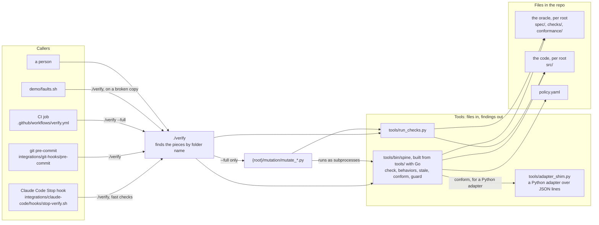
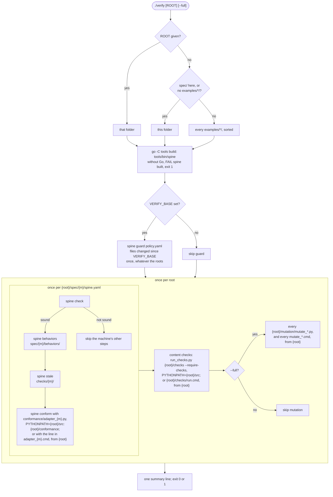
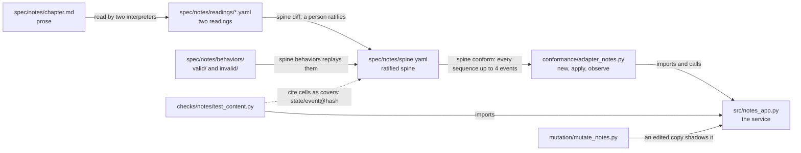
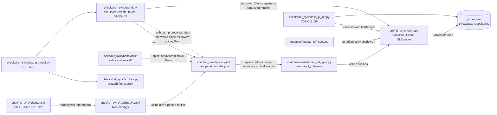
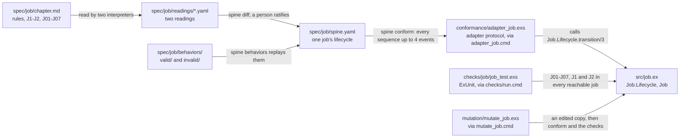
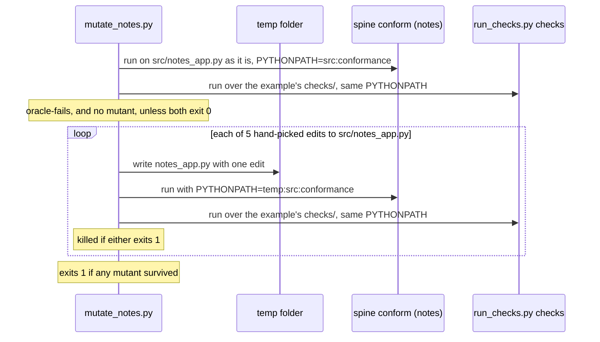
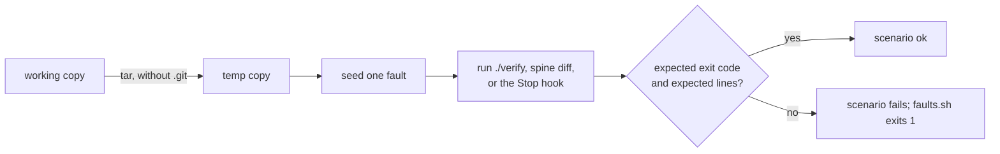

# Architecture

How the repo fits together today: who calls what, what `./verify` runs, how the examples are
wired, and how the toolkit checks itself. The rules each piece follows are in
`docs/reference/`; the reasons are in `docs/design.md`. In the diagrams, `{m}` is a machine's
folder name, such as `notes`, and `{root}` is the folder `./verify` checks: a project laid out
with `spec/`, `checks/`, `conformance/`, `src/` and `mutation/`. In this repo each
`examples/<name>/` is a root; a project that uses the toolkit is its own root.

## Layers

Callers know about `./verify`. `./verify` knows the folder layout. The tools know only the
files they are given.

## What `./verify` runs

Each adapter, the content checks and each mutation script is given as Python or as a `.cmd`
file holding one command line, for code in any language. A command runs from its root, without
a shell, with `VERIFY_SPINE` set to the command line that runs `spine`; checks and mutation
pass when it exits 0. A Python mutation script gets `VERIFY_SPINE` too. `spine` is the Go one,
which `./verify` builds into `tools/bin/spine` before anything else, and `./verify` exports
`PYTHON`, the interpreter it picked, which `spine` serves a Python adapter with
(`docs/adr/0006-retire-spine-py.md`).

A step that cannot run because a piece is missing is an error, not a skip, reported per root:
no spine at all (`no-machines`), no adapter for a machine (`no-adapter`), no `test_*` function
anywhere under the root's `checks/` and no `checks/run.cmd` (`no-checks`), or no mutation
script under `--full` (`no-mutation`). So is a piece given both ways (`ambiguous-piece`), and a
`.cmd` file that holds no single command line (`bad-command`). A root other than the repo
itself starts with a `== <root>` line.

## The notes example

The first example, in `examples/notes/`; the paths below are relative to it. Its files
are tied together by the name `notes`, by Python imports, and by the cell hashes the checks
cite.

Who may change what, from `policy.yaml` (enforced by `spine guard` when `VERIFY_BASE` is set):

| Branch | Role | May change | May not change |
|---|---|---|---|
| `build/*` | builder | `examples/*/src/`, `docs/`, `README.md` | `examples/*/spec/`, `examples/*/checks/`, `examples/*/conformance/`, `examples/*/mutation/`, `tools/`, `integrations/`, `verify`, `policy.yaml`, `.claude/`, `.github/`, `.gitlab/`, CODEOWNERS |
| `spec/*` | spec-author | `examples/*/spec/`, `examples/*/checks/`, `examples/*/conformance/` | `examples/*/src/` |
| anything else | person | everything | |

## The ref_sync example

In `examples/ref_sync/`; the paths below are relative to it. Its spine is one operation's
lifecycle, which `spine conform` checks through the client's pure `transition()`. Two clients
racing, lost replies and crashes are checked by its own explorer, and Git's assumed behavior by
checks against real Git. The adapter's docstring is the whole contract between the oracle and
`src/`.

The explorer is generic: `explore.py` knows nothing of Git, and `world.py` holds the moves, the
faults and the invariants. `git` is a dependency of this example only; without it the Git
checks fail.

## The elixir_job example

In `examples/elixir_job/`; the paths below are relative to it. It is in Elixir, so its adapter,
content checks and mutation are `.cmd` files, each holding one command line that `./verify`
runs from this folder. Every command loads `src/**/*.ex` with `elixir -pr`; there is no Mix
project. The spine is one job's lifecycle, which `spine conform` checks through the job's pure
`Job.Lifecycle.transition/3`, taking `attempts` as given; the content checks drive `Job`
itself, which counts its own attempts.

## Checking the checker

`./verify --full` runs each example's mutation script. `examples/notes/mutation/mutate_notes.py`
breaks the service on purpose and expects the oracle to notice. It runs from the example's
folder, finds `tools/` above it, and runs `conform` through `VERIFY_SPINE`.
`examples/ref_sync/mutation/mutate_ref_sync.py` works the
same way with six edits to `src/ref_sync_client.py`, and names every check that failed.
`examples/elixir_job/mutation/mutate_job.exs` makes five edits to `src/job.ex`, each in a copy
of the example, and runs `conform` through `VERIFY_SPINE` and the command in `checks/run.cmd`
there. Each script first runs the oracle on the code as it is, and stops with `oracle-fails`
unless conformance passes and the checks pass or find none, because an oracle that already
fails would count every mutant as caught.

## Acceptance: `demo/faults.sh` and CI

`demo/faults.sh` is the toolkit's own acceptance test. Each scenario makes a fresh copy of the
repo (without `.git`) in a temp folder, seeds one fault, runs a command there, and checks the
exit code and the lines it must print. Scenarios 0 to 10 seed faults in the notes example, and
`./verify` in the copy checks every example, so ref_sync's and elixir_job's checks run in each of
them too. Scenarios 11 to 13 seed faults in elixir_job and check it alone. Scenario 14 breaks
the code of all three examples, so that each mutation script finds its oracle failing.
Scenarios 15 to 17 run the Stop hook and read its reply as JSON, as Claude Code does: on a
machine without `python3`, on failing lines that hold characters JSON must escape, and with a
project folder that doesn't exist.

| # | Fault seeded | Command | Must print |
|---|---|---|---|
| 0 | none | `./verify --full` | `all steps passed` |
| 1 | the service as first written | `./verify` | two `diverges` lines with their sequences |
| 2 | the notes spine lets editors restore | `./verify` | `behavior-allowed`, `stale-check`, `diverges` |
| 3 | `on:` instead of `event:` in the notes spine | `./verify` | `yaml-boolean-key`, and the notes steps skipped |
| 4 | a `build/*` branch edits the notes spine | `VERIFY_BASE=main ./verify` | `path-denied examples/notes/spec/notes/spine.yaml` |
| 5 | none (two readings) | `spine diff` on the notes readings | two `case-disagrees` lines |
| 6 | notes content checks deleted | `./verify --full` | `mutant-survived` for the upper-case mutant |
| 7 | the service as first written | the Stop hook, twice | a block, then the attempt-cap warning |
| 8 | the notes adapter, content checks and mutation removed | `./verify --full` | `no-adapter`, `no-checks`, `no-mutation` |
| 9 | the notes service imports a module that doesn't exist | `./verify examples/notes` | `adapter-failed`, `check-unloadable` |
| 10 | the service as first written | `spine conform --adapter-cmd` through the shim | the same `diverges` lines as scenario 1 |
| 11 | the job retries after its last attempt fails | `./verify examples/elixir_job` | `diverges running/fail attempts=last` |
| 12 | the job counts one attempt too many | `./verify examples/elixir_job` | conformance `ok`, content checks `FAIL` with J03 |
| 13 | elixir_job's content checks deleted | `./verify examples/elixir_job --full` | `no checks ran`, and `mutant-survived` for a counting mutant |
| 14 | the code of all three examples, as in scenarios 1 and 11 and ref_sync's first mutant | `./verify --full` | `oracle-fails` from each mutation script |
| 15 | no `python3` on the PATH, and no session id | the Stop hook, twice | a block with the failing lines, then the attempt-cap warning, each saying every session shares the count |
| 16 | `./verify` prints failing lines with quotes, backslashes, control characters and a byte that isn't UTF-8 | the Stop hook | a block whose failing lines are exactly those |
| 17 | the project folder given to the Stop hook doesn't exist | the Stop hook | a block saying `./verify` did not run |

This repo's CI (`.github/workflows/verify.yml`) runs `go vet` and `go test`, then
`./verify --full`, then `demo/faults.sh`, on every pull request and push to `main`. It does
not set `VERIFY_BASE`, so the path guard runs here only inside scenario 4.

`go test` holds the cases test (`tools/internal/spine/cases_test.go`). It runs the Go `spine`
(`tools/cmd/spine/`, `tools/internal/spine/`, one module in `tools/`) on every input it has,
among them the repo's spines, readings, behaviors, checks, adapters and policy and the faults
scenarios 1 to 4, 9 and 10 seed. Between them they give every finding code the contract lists.

Each run must give exactly what the record holds (`tools/internal/spine/testdata/record/`,
written by `record_test.go` beside it): its exit code and output, and in JSON runs the JUnit
report, with the paths that differ between machines written as `$ROOT` and `$TMP`.
`go -C tools test ./internal/spine/ -update` writes the record again; its diff is what a
reviewer reads. The record was written while the Go `spine` still matched `tools/spine.py` on
every input, before that retired (#44).

## Per machine, per root and repo-wide

| Part | Scope today | How it finds its inputs |
|---|---|---|
| `spine check`, `behaviors`, `stale`, `conform` | per machine | `{root}/spec/{m}/`, `{root}/checks/{m}/`, `{root}/conformance/adapter_{m}.py` or `.cmd` |
| content checks | per root: one run over all of `{root}/checks/` | every `test_*.py` under `{root}/checks/`, or `{root}/checks/run.cmd` |
| mutation | per root: every `{root}/mutation/mutate_*.py` and `mutate_*.cmd` under `--full` | file name pattern; each script runs all of its root's `checks/` |
| `src/` | per root: on `PYTHONPATH` for Python, loaded by the commands otherwise | module name (`notes_app`, `ref_sync_client`); elixir_job's commands load `src/**/*.ex` |
| path guard | repo-wide | `policy.yaml` patterns over `examples/*/` and the toolkit's folders |
| deny rules, CODEOWNERS (`integrations/`) | a project's root | folder patterns for a project with `spec/` at its root |
| `demo/faults.sh` | seeds faults in notes (0-10), elixir_job (11-13) and all three examples (14) | hard-coded `examples/notes/`, `examples/elixir_job/` and `examples/ref_sync/` paths |
| `demo/live-builder.sh` | notes only | hard-coded `examples/notes/` paths |
| choosing what to run | one root per call | `./verify ROOT`; without it, the discovery rule above |
