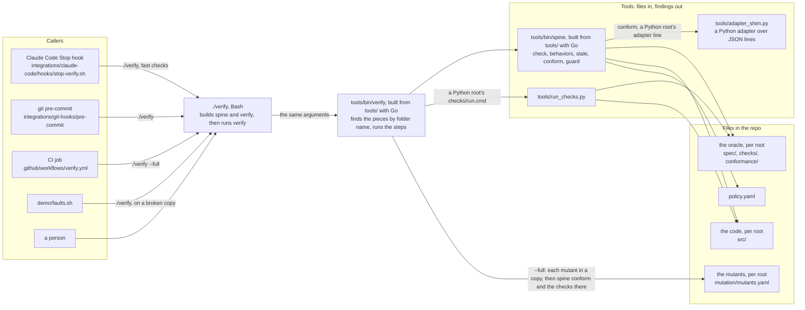
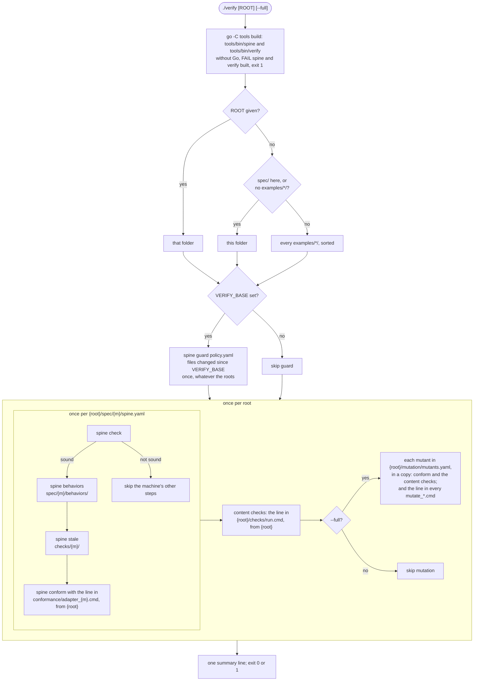
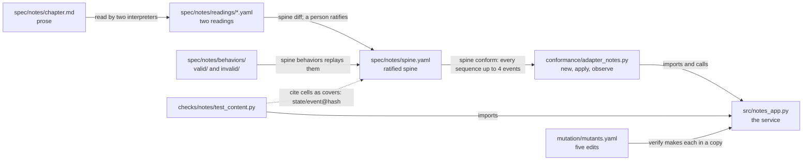
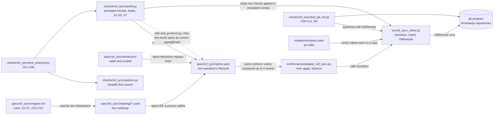
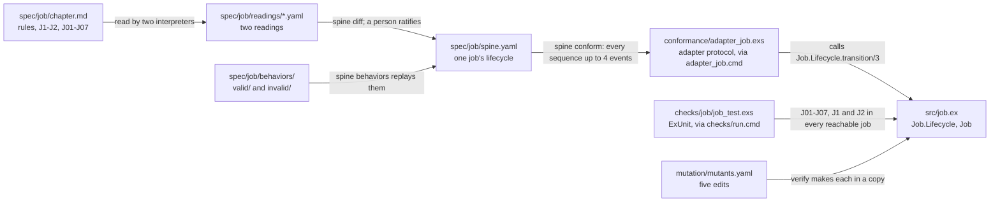
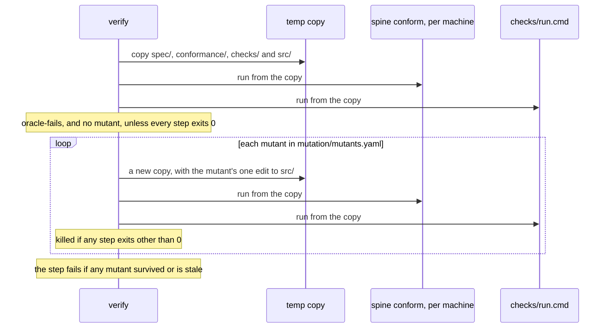
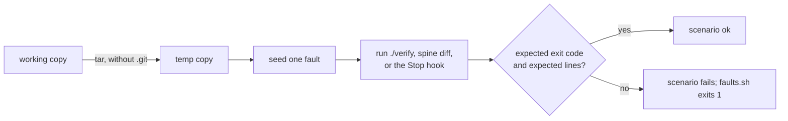

# Architecture

How the repo fits together today: who calls what, what `./verify` runs, how the examples are
wired, and how the toolkit checks itself. The rules each piece follows are in
`docs/reference/`; the reasons are in `docs/design.md`. In the diagrams, `{m}` is a machine's
folder name, such as `notes`, and `{root}` is the folder `./verify` checks: a project laid out
with `spec/`, `checks/`, `conformance/`, `src/` and `mutation/`. In this repo each
`examples/<name>/` is a root; a project that uses the toolkit is its own root.

## Layers

Callers know about `./verify`. `./verify` knows the folder layout. The tools know only the
files they are given.

## What `./verify` runs

Each adapter and the content checks are a `.cmd` file holding one command line, in any
language (`docs/adr/0007-no-language-built-in.md`), and so is a mutation tool's command,
`mutation/mutate_<name>.cmd`. How `./verify` runs them, and what it gives them, is in the
contract's section on `./verify` (`docs/reference/tool-contract.md`).

`./verify` is a short Bash script. Before anything else it builds `spine` and `verify` into
`tools/bin/` with Go, then runs `verify` with its arguments, and `verify` does all of the above
(`tools/cmd/verify/`, `tools/internal/verify/`). Its decisions are pure functions, in
`plan.go`: reading the arguments, planning each root's steps from what the root holds, and what
each step prints. `verify.go` reads the files and starts the programs around them, and decides
nothing (`docs/adr/0007-no-language-built-in.md`, decision 1). `verify` runs `spine` only as a
program. The two share what both need: `tools/internal/shlex`, which splits a command line, and
`tools/internal/program`, which starts one and words the system's errors.

A step that cannot run because a piece is missing is an error, not a skip, reported per root:
no spine at all (`no-machines`), no adapter for a machine (`no-adapter`), no `checks/run.cmd`
(`no-checks`), or no mutants under `--full` (`no-mutation`). So is a `.cmd` file that
holds no single command line, or whose program can't be started (`bad-command`). A root other than the repo
itself starts with a `== <root>` line.

## The notes example

The first example, in `examples/notes/`; the paths below are relative to it. Its files
are tied together by the name `notes`, by Python imports, and by the cell hashes the checks
cite.

Who may change what, from `policy.yaml` (enforced by `spine guard` when `VERIFY_BASE` is set):

| Branch | Role | May change | May not change |
|---|---|---|---|
| `build/*` | builder | `examples/*/src/`, `docs/`, `README.md` | `examples/*/spec/`, `examples/*/checks/`, `examples/*/conformance/`, `examples/*/mutation/`, `tools/`, `integrations/`, `verify`, `policy.yaml`, `.claude/`, `.github/`, `.gitlab/`, CODEOWNERS |
| `spec/*` | spec-author | `examples/*/spec/`, `examples/*/checks/`, `examples/*/conformance/` | `examples/*/src/` |
| anything else | person | everything | |

## The ref_sync example

In `examples/ref_sync/`; the paths below are relative to it. Its spine is one operation's
lifecycle, which `spine conform` checks through the client's pure `transition()`. Two clients
racing, lost replies and crashes are checked by its own explorer, and Git's assumed behavior by
checks against real Git. The adapter's docstring is the whole contract between the oracle and
`src/`.

The explorer is generic: `explore.py` knows nothing of Git, and `world.py` holds the moves, the
faults and the invariants. `git` is a dependency of this example only; without it the Git
checks fail.

## The elixir_job example

In `examples/elixir_job/`; the paths below are relative to it. It is in Elixir; its adapter and
content checks are `.cmd` files, each holding one command line that `./verify`
runs from this folder. Every command loads `src/**/*.ex` with `elixir -pr`; there is no Mix
project. The spine is one job's lifecycle, which `spine conform` checks through the job's pure
`Job.Lifecycle.transition/3`, taking `attempts` as given; the content checks drive `Job`
itself, which counts its own attempts.

## Checking the checker

`./verify --full` makes each example's mutants, listed in `mutation/mutants.yaml`, each one edit
to a file under `src/` (#58). For each root it runs the steps that read `src/`, each machine's
`conform` and the content checks, first on the code as it is and then on each mutant, every
time in a new temporary copy of the root's `spec/`, `conformance/`, `checks/` and `src/`. If a
step fails on the code as it is, it reports `oracle-fails` and makes no mutant, because an
oracle that already fails would count every mutant as caught. A mutant is killed when any step
exits other than 0, survives when all pass, and is stale when its text isn't in its file exactly
once. This is `verify`'s own code, in every language alike (`mutants.go` for the decisions,
`verify.go` for the copies); a project with a mutation tool gives its command as
`mutation/mutate_<name>.cmd`, which runs as a step of its own.

## Acceptance: `demo/faults.sh` and CI

`demo/faults.sh` is the toolkit's own acceptance test. Each scenario makes a fresh copy of the
repo (without `.git`) in a temp folder, seeds one fault, runs a command there, and checks the
exit code and the lines it must print. Scenarios 0 to 9 seed faults in the notes example, and
`./verify` in the copy checks every example, so ref_sync's and elixir_job's checks run in each of
them too. Scenarios 11 to 13 seed faults in elixir_job and check it alone. Scenario 14 breaks
the code of all three examples, so that each example's mutants stop at `oracle-fails`.
Scenarios 15 to 17 run the Stop hook and read its reply as JSON, as Claude Code does: on a
machine without `python3`, on failing lines that hold characters JSON must escape, and with a
project folder that doesn't exist.

| # | Fault seeded | Command | Must print |
|---|---|---|---|
| 0 | none | `./verify --full` | `all steps passed` |
| 1 | the service as first written | `./verify` | two `diverges` lines with their sequences |
| 2 | the notes spine lets editors restore | `./verify` | `behavior-allowed`, `stale-check`, `diverges` |
| 3 | `on:` instead of `event:` in the notes spine | `./verify` | `yaml-boolean-key`, and the notes steps skipped |
| 4 | a `build/*` branch edits the notes spine | `VERIFY_BASE=main ./verify` | `path-denied examples/notes/spec/notes/spine.yaml` |
| 5 | none (two readings) | `spine diff` on the notes readings | two `case-disagrees` lines |
| 6 | notes content checks replaced by one that never looks at the text | `./verify --full` | `mutant-survived` for the upper-case mutant |
| 7 | the service as first written | the Stop hook, twice | a block, then the attempt-cap warning |
| 8 | the notes adapter, content checks and mutants removed | `./verify --full` | `no-adapter`, `no-checks`, `no-mutation` |
| 9 | the notes service imports a module that doesn't exist | `./verify examples/notes` | `adapter-failed`, `check-unloadable` |
| 10 | unused since #69, when notes' adapter became a command line: scenario 1 runs it through the adapter protocol | | |
| 11 | the job retries after its last attempt fails | `./verify examples/elixir_job` | `diverges running/fail attempts=last` |
| 12 | the job counts one attempt too many | `./verify examples/elixir_job` | conformance `ok`, content checks `FAIL` with J03 |
| 13 | elixir_job's checks that count attempts deleted (J03, J04 and every reachable job) | `./verify examples/elixir_job --full` | content checks `ok`, and `mutant-survived` for a counting mutant |
| 14 | the code of all three examples, as in scenarios 1 and 11 and ref_sync's first mutant | `./verify --full` | `oracle-fails` for each example's mutants |
| 15 | no `python3` on the PATH, and no session id | the Stop hook, twice | a block with the failing lines, then the attempt-cap warning, each saying every session shares the count |
| 16 | `./verify` prints failing lines with quotes, backslashes, control characters and a byte that isn't UTF-8 | the Stop hook | a block whose failing lines are exactly those |
| 17 | the project folder given to the Stop hook doesn't exist | the Stop hook | a block saying `./verify` did not run |

This repo's CI (`.github/workflows/verify.yml`) runs `go vet` and `go test` in `tools/`, then
`go test` in `examples/`, which checks the conventions every example follows
(`examples/README.md`), then `./verify --full`, then `demo/faults.sh`, on every pull request and
push to `main`. It does
not set `VERIFY_BASE`, so the path guard runs here only inside scenario 4.

`go test` holds the cases test (`tools/internal/spine/cases_test.go`). It runs the Go `spine`
(`tools/cmd/spine/`, `tools/internal/spine/`, one module in `tools/`) on every input it has,
among them the repo's spines, readings, behaviors, checks, adapters and policy and the faults
scenarios 1 to 4, 9 and 10 seed. Between them they give every finding code the contract lists.

Each run must give exactly what the record holds (`tools/internal/spine/testdata/record/`,
written by `record_test.go` beside it, in the format `tools/internal/record` reads and writes):
its exit code and output, the message on standard error of a usage error, and in JSON runs the
JUnit report, with the paths that differ between machines written as `$ROOT` and `$TMP` (#44).
`go -C tools test ./internal/spine/ -update` writes the record again; its diff is what a
reviewer reads.

`go test` also holds the record of `./verify` (`tools/internal/verify/record_test.go`, #68).
It copies `verify` and `tools/` into fixture projects, as a project does, and runs `./verify`
in them as its callers do. Between them the fixtures reach every path through it: misuse, a
failed build, which roots run, the guard, every skip, each piece as a command line, passing and
failing, each missing piece, each `bad-command`, and a root that gives its pieces only by
Python file names. Each run must give exactly what
`tools/internal/verify/testdata/record/` holds: its exit code, standard output, standard error
and every JUnit report, with the test's temporary folder written as `$TMP`. Every run is in the
C locale. The fixtures need no Elixir.
`go -C tools test ./internal/verify/ -update` writes the record again. It was written from the
Bash `./verify`, and is what the change to commands (#69) and the Go `verify` (#70) were checked
against. Beside it, `plan_test.go` tests each of `verify`'s decisions without starting a
program.

## Per machine, per root and repo-wide

| Part | Scope today | How it finds its inputs |
|---|---|---|
| `spine check`, `behaviors`, `stale`, `conform` | per machine | `{root}/spec/{m}/`, `{root}/checks/{m}/`, `{root}/conformance/adapter_{m}.cmd` |
| content checks | per root: one run over all of `{root}/checks/` | `{root}/checks/run.cmd` |
| mutation | per root, under `--full`: `{root}/mutation/mutants.yaml`, and every `{root}/mutation/mutate_*.cmd` | the file's name, and a file name pattern; each mutant runs every machine's `conform` and all of `checks/`, in a copy |
| `src/` | per root: loaded by the commands | module name (`notes_app`, `ref_sync_client`), with `src/` on `PYTHONPATH` from the line; elixir_job's commands load `src/**/*.ex` |
| path guard | repo-wide | `policy.yaml` patterns over `examples/*/` and the toolkit's folders |
| deny rules, CODEOWNERS (`integrations/`) | a project's root | folder patterns for a project with `spec/` at its root |
| `demo/faults.sh` | seeds faults in notes (0-9), elixir_job (11-13) and all three examples (14) | hard-coded `examples/notes/`, `examples/elixir_job/` and `examples/ref_sync/` paths |
| `demo/live-builder.sh` | notes only | hard-coded `examples/notes/` paths |
| choosing what to run | one root per call | `./verify ROOT`; without it, the discovery rule above |
